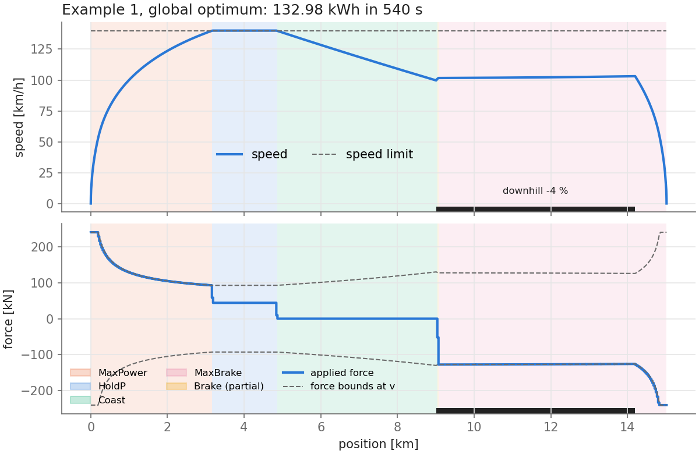
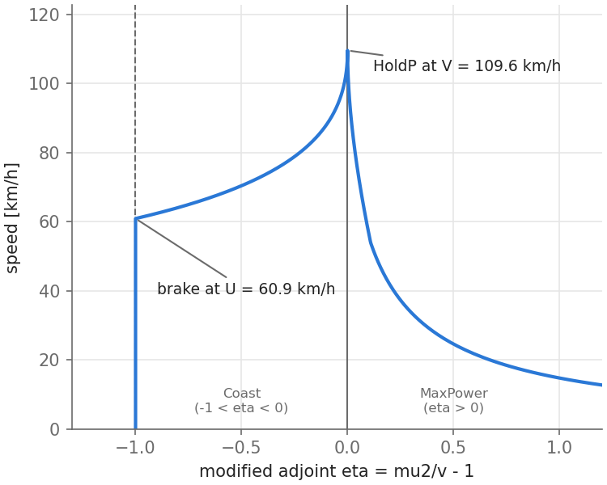
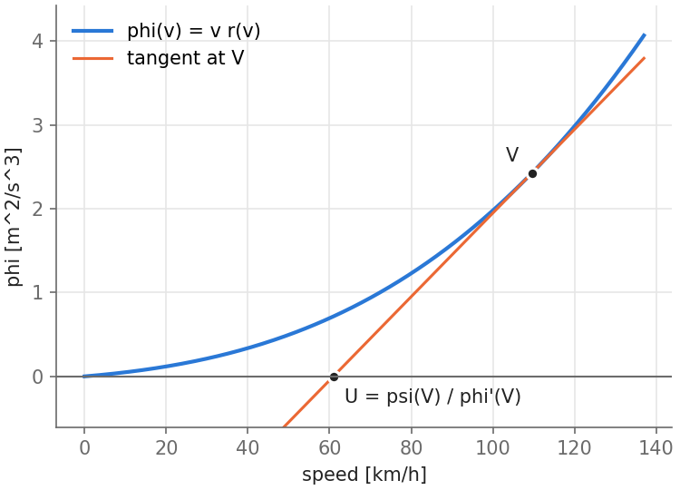
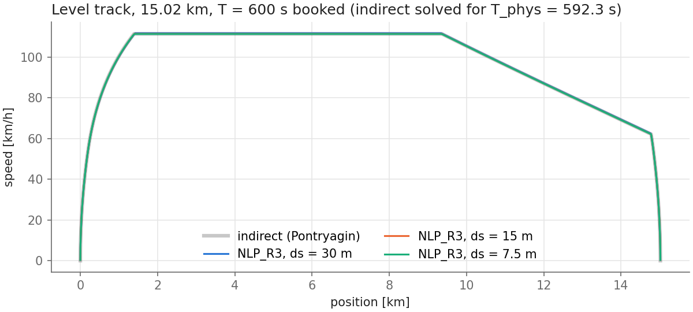
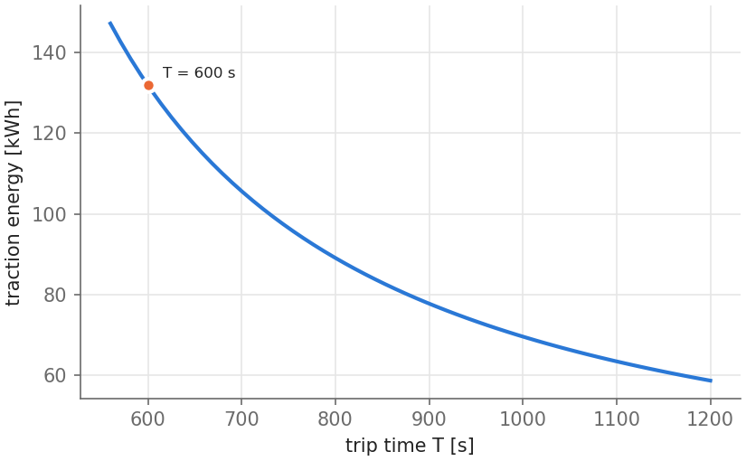

# Optimal train eco-driving: direct and indirect methods

How should a train be driven between two stations so that it arrives on time with the least traction energy? This repository solves the problem in two independent ways and checks that they agree:

- **Direct method:** the nonconvex NLP model $\text{NLP}_{R3}$ of Xiao, Ye & Chung (2025), solved to **global** optimality by spatial branch-and-bound (Gurobi or SCIP).
- **Indirect method:** Pontryagin's maximum principle as developed by Albrecht, Howlett et al. (2016). The optimal strategy is a sequence of driving modes, and every switch follows from the adjoint variable.

This is the offline part of my project *Online planning of train eco-driving with model predictive control* (Optimierung und Simulation, M.Sc. Optimierung, HSBI, summer term 2025). The optimal trajectories computed here are the reference for the moving-horizon controller, which is published as a separate repository.

<p align="center">
  
</p>

## Problem

A point-mass train (Table 1 of Xiao et al.: $m = 400$ t, $P_{\max} = 3.6$ MW, $F_{\max} = 240$ kN, Davis resistance $R(v) = 5.84 + 0.4 v + 0.015 v^2$ kN) runs a distance $S$ in a time $T$:

$$\min \int_0^S F^+(s)\, ds \quad \text{s.t.} \quad \frac{d}{ds}\Big(\frac{v^2}{2}\Big) = \frac{F - R(v) - m g \sin\alpha(s)}{m}, \quad \frac{dt}{ds} = \frac{1}{v}, \quad F_{\min} \le F \le F_{\max}, \quad P_{\min} \le F v \le P_{\max}, \quad v \le v_{\max}(s),$$

with $t(S) \le T$ and the train at rest at both ends. Position $s$ is the independent variable.

## Methods

**Direct: $\text{NLP}_{R3}$** ([`nlpr3.py`](src/train_eco/nlpr3.py)). The states are the kinetic energy per unit mass $E$, the speed $v$ and the time $t$, discretised by an implicit Euler scheme in $s$. Two ideas make the problem tractable:

- **Linear dynamics.** The term $c_2 v^2$ becomes $2 c_2 E$, and $E_k = v_k^2/2$ is kept as a separate (bilinear) constraint.
- **Latency.** A latency $z_k$ with $t_k - t_{k-1} = \Delta s_k z_k$ and the **convex relaxation** $z_k \ge 1/v_k$ (a rotated second-order cone, $1 \le v_k z_k$). Proposition 1 of the paper shows that this relaxation is tight at the optimum.

The only nonconvex constraints are then the bilinear terms $E_k = v_k^2/2$ and $P_{\min} \le F_k v_k \le P_{\max}$, which a spatial branch-and-bound solver handles exactly. The valid inequalities $E_k \ge v_k^2/2$ and $P_{\min} z_k \le F_k \le P_{\max} z_k$ tighten the McCormick relaxations used internally by the solver.

**Indirect: Pontryagin** ([`indirect.py`](src/train_eco/indirect.py)). On level track and without regenerative braking, the optimal strategy is

$$\text{MaxPower} \;\to\; \text{HoldP at } V \;\to\; \text{Coast} \;\to\; \text{MaxBrake}.$$

The modified adjoint $\eta = \mu_2/v - 1$ decides the mode: $\eta > 0$ for MaxPower, $\eta = 0$ for holding the speed, $-1 < \eta < 0$ for Coast, and $\eta = -1$ for braking. Along each phase $\eta$ is an explicit function of $v$.

The switch from Coast to MaxBrake happens at a speed $U$ with a neat geometric meaning. **The tangent to the convex curve $\varphi(v) = v\,r(v)$ at the holding speed $V$ crosses the $v$-axis at $U = \psi(V)/\varphi'(V)$**, where $\psi(v) = v^2 r'(v)$.

Each phase is an integral in $v$. The length of the HoldP phase closes the distance, and a root search on $V$ meets the trip time. One optimal journey takes milliseconds.

<p align="center">
  
  
</p>

## Results

### Example 1 of Xiao et al.: global optimum

The route is 15.02 km with $N = 520$ segments (10 + 10 segments of 1 m at the ends, 500 of 30 m), a 140 km/h limit, a 4 % downhill section on segments 311–483, $T = 540$ s and $\eta_{reg} = 0$.

| | |
|---|---|
| Traction energy | **132.98 kWh** (478.7 MJ) |
| Optimality gap | 0.01 % (Gurobi 12, 12.7 s on 32 threads; SCIP 10: 0.008 % in 475 s; the paper reports 4.4 s with Gurobi 11) |
| $\max_k (z_k - 1/v_k)$ | $10^{-11}$: the latency relaxation is tight |
| Time from $\sum \Delta s_k / v_k$ | 540.0 s = booked time |

The optimal strategy (figure above) is MaxPower up to the speed limit, Hold at 140 km/h, a long Coast, and **maximum braking along the entire downhill section**. Braking at its power limit cannot hold the speed on a 4 % grade above about 101 km/h, so the train has to enter the downhill slowly enough. That is why it coasts from km 4.9 onwards.

The trip time is tight: 540 s is close to the minimum running time of this discrete model (about 525 s).

### Direct vs. indirect method on level track

This test uses the same route without the downhill section and $T = 600$ s, so the speed limit is not active and the theory of Section 3.6 of Part 1 applies. NLP$_{R3}$ is solved on meshes of 30, 15 and 7.5 m; the indirect method is continuous.

| $N$ | $\Delta s$ | NLP$_{R3}$ [kWh] | Gap (Gurobi) | $T_\text{phys}$ [s] | Indirect at $T_\text{phys}$ [kWh] | Difference |
|---|---|---|---|---|---|---|
| 520 | 30 m | 135.052 | 0.005 % (4 s) | 590.8 | 135.056 | −0.003 % |
| 1020 | 15 m | 134.590 | 0.008 % (15 s) | 591.9 | 134.651 | −0.045 % |
| 2020 | 7.5 m | 134.447 | 0.009 % (13 s) | 592.3 | 134.535 | −0.066 % |



- **Both methods give the same trajectory.** The switching points of the NLP and the indirect solution coincide, and the energies agree to within 0.07 %.
  - Gurobi certifies all three NLPs as globally optimal within seconds. SCIP finds the same solutions but stalls in its LP solver on the finer meshes (gaps of 0.4–18 % after 25 min); there the indirect solution serves as an independent certificate.
- **Why $T_\text{phys}$ instead of $T$:** this is the time-bookkeeping note below.

Since one journey takes milliseconds, the indirect method gives the full energy–time trade-off almost for free:

<p align="center"></p>

### Notes on the discrete model

1. **The latency constraint must stay exact.** It is tempting to replace $z_k \ge 1/v_k$ by a McCormick envelope of $y_k = v_k z_k$ together with $y_k \ge 1$, as I did in the first version of this project. The envelope is an outer approximation, so it admits $z_k < 1/v_k$: the model books less time than the train needs. On Example 1, the "solution" uses only 81 kWh, but driving its speed profile takes **674 s instead of 540 s** (`scripts/pitfall_mccormick.py`). McCormick envelopes belong *inside* the branch-and-bound, not in the model.
2. **Time bookkeeping at the ends of the trip.** The implicit Euler scheme charges $t_k - t_{k-1} = \Delta s_k / v_k$ with the speed at the *end* of the segment.
   - On the last segment $v_N = \varepsilon = 0.1$ m/s, so the last metre costs 10 s, while braking through it takes about 1.6 s.
   - The discrete model therefore has about 9 s less physical driving time than $T$; this is why the trapezoidal time $T_\text{phys} = \sum 2\Delta s_k/(v_{k-1}+v_k)$ is used for the comparison above.
   - The 1 m segments at both ends, used by Xiao et al., keep this error small. It does not vanish as the mesh is refined.
3. **Index convention.** In (18b)–(18i) all quantities of segment $k$ are evaluated at its end node $s_k$. Coupling the latency of the first segment to the *initial* speed $v_0 = \varepsilon$ instead forces $\Delta s_1/\varepsilon$ seconds of standstill (100 s for a 10 m segment).
   - Together with note 1, this explains the 144.5 kWh of my original course submission.

## Project structure

```
train-eco-driving-optimal/
├── src/train_eco/
│   ├── model.py       # train data (Table 1), Example 1, level-track variant
│   ├── nlpr3.py       # NLP_R3, Gurobi and SCIP back ends
│   ├── indirect.py    # Pontryagin: phases, brake speed, outer loop on V, adjoint
│   ├── checks.py      # solver-independent physical checks (dynamics, z = 1/v, time)
│   ├── export.py      # CSV/JSON export, classification of driving modes
│   └── plotting.py
├── scripts/
│   ├── solve_example1.py      # global optimum of Example 1
│   ├── compare_indirect.py    # direct vs indirect, energy-time trade-off
│   └── pitfall_mccormick.py   # note 1
├── tests/                     # regression tests (seconds)
├── results/                   # solutions (CSV) and solver metadata (JSON)
└── figures/
```

## Usage

```bash
pip install -r requirements.txt

python -m pytest tests                               # a few seconds
python scripts/solve_example1.py                     # Gurobi (full license), seconds
python scripts/solve_example1.py --solver scip       # open source, ~8 min
python scripts/compare_indirect.py --reuse           # indirect part only, with the stored NLP solutions
python scripts/compare_indirect.py --solver gurobi   # re-solve the three NLPs
python scripts/pitfall_mccormick.py --solver scip
```

The pip version of Gurobi comes with a size-limited license, which is too small for $N = 520$. SCIP (`pyscipopt`) is the open-source alternative. The stored results in `results/` were computed with Gurobi 12 (academic license).

## Future work

- [ ] Indirect method on steep track and with speed limits (Energymiser algorithm, Albrecht et al. 2016, Part 2): in Example 1 the speed limit and the braking capacity on the downhill section are active, which the level-track solver does not cover.
- [ ] Regenerative braking ($\eta_{reg} > 0$, HoldR phases at $W = \psi^{-1}(\psi(V)/\rho)$) in both methods.
- [ ] A time discretisation without the end-of-trip bias (note 2), e.g. trapezoidal latency, and its effect on the tightness of $z \ge 1/v$.
- [ ] Time windows and the green-wave fleet problem (Sections 4–5 of Xiao et al.).
- [ ] Moving-horizon MPC that tracks these trajectories in real time (separate repository).

## References

- Z. Xiao, H. Ye, E. Chung (2025). New formulations and solution approaches for train eco-driving problems. Preprint, The Hong Kong Polytechnic University.
- A. Albrecht, P. Howlett, P. Pudney, X. Vu, P. Zhou (2016). The key principles of optimal train control—Part 1: Formulation of the model, strategies of optimal type, evolutionary lines, location of optimal switching points. *Transportation Research Part B* 94, 482–508.
- A. Albrecht, P. Howlett, P. Pudney, X. Vu, P. Zhou (2016). The key principles of optimal train control—Part 2: Existence of an optimal strategy, the local energy minimization principle, uniqueness, computational techniques. *Transportation Research Part B* 94, 509–538.
- P. Belotti et al. (2013). Mixed-integer nonlinear optimization. *Acta Numerica* 22, 1–131.
- K. Bestuzheva et al. (2023). Global optimization of mixed-integer nonlinear programs with SCIP 8. *Journal of Global Optimization.*
